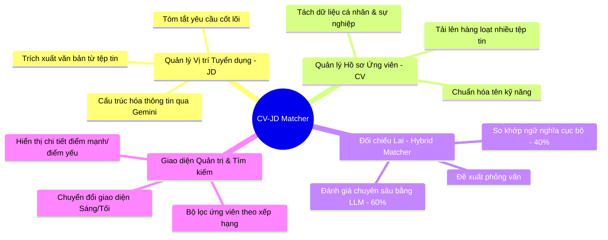
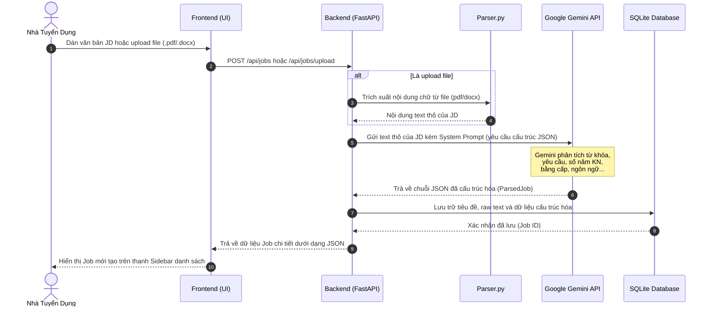
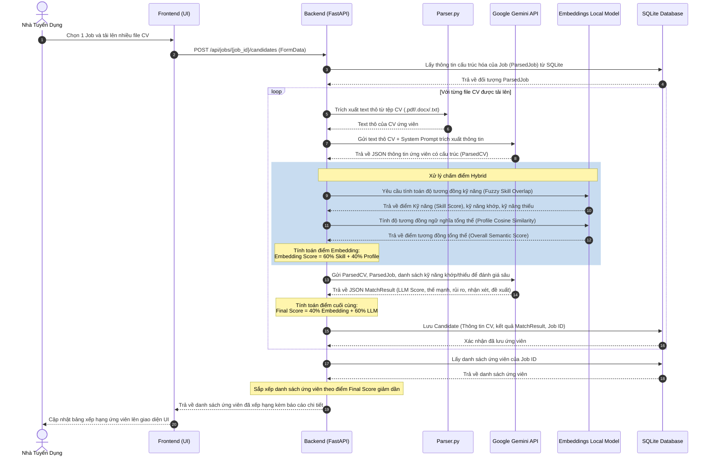
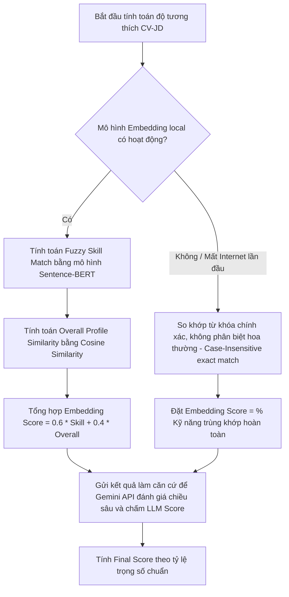

# BÁO CÁO PHÂN TÍCH HỆ THỐNG CV-JD MATCHER 📊

Tài liệu này cung cấp cái nhìn chi tiết về kiến trúc phần mềm, các chức năng cốt lõi, ngăn xếp công nghệ sử dụng, giải thích thuật toán chấm điểm và mô tả trực quan các luồng dữ liệu chính của hệ thống **CV-JD Matcher**.

---

## 1. Phân Tích Các Chức Năng Chính

Hệ thống được thiết kế với mục tiêu tối ưu hóa quy trình sàng lọc hồ sơ ban đầu của nhà tuyển dụng. Thay vì phải đọc thủ công từng CV, hệ thống tự động hóa quá trình này qua 4 chức năng cốt lõi:



### 1.1. Quản lý Vị trí Tuyển dụng (Job Description - JD)
- **Đầu vào**: Chấp nhận văn bản thô dán trực tiếp hoặc tải tệp văn bản (`.pdf`, `.docx`, `.txt`, `.md`).
- **Xử lý trích xuất**: Sử dụng Gemini AI phân tích nội dung JD để bóc tách thành định dạng JSON có cấu trúc ([ParsedJob](file:///run/user/1000/doc/6d185d17/cv-jd-matcher/backend/app/models.py#L12-L23)):
  - Tiêu đề công việc (`title`), cấp bậc tuyển dụng (`seniority_level` như Intern, Junior, Mid, Senior, Lead...).
  - Kỹ năng bắt buộc (`required_skills`) và kỹ năng ưu tiên (`preferred_skills`).
  - Số năm kinh nghiệm tối thiểu yêu cầu (`min_years_experience`).
  - Yêu cầu bằng cấp (`education_requirement`), ngoại ngữ (`languages_required`).
  - Danh sách trách nhiệm cốt lõi (`responsibilities`) và tóm tắt ngắn gọn vị trí (`summary`).

### 1.2. Quản lý Hồ sơ Ứng viên (CV Parsing)
- **Đầu vào**: Hỗ trợ tải lên đồng thời nhiều tệp tin CV cùng lúc dưới các định dạng tài liệu phổ biến.
- **Xử lý trích xuất**: Chuyển đổi file sang văn bản thô, sau đó sử dụng Gemini AI để phân loại và cấu trúc thành schema ([ParsedCV](file:///run/user/1000/doc/6d185d17/cv-jd-matcher/backend/app/models.py#L41-L53)):
  - Thông tin cá nhân cơ bản: Họ tên, email, số điện thoại, địa điểm hiện tại.
  - Tổng số năm kinh nghiệm (`total_years_experience`) - tự động tính toán/ước lượng dựa trên dòng thời gian làm việc.
  - Danh sách kỹ năng chuyên môn (`skills`) đã được chuẩn hóa.
  - Kinh nghiệm làm việc chi tiết (`work_experience`) bao gồm: Công ty, vị trí, thời gian bắt đầu/kết thúc, số năm làm việc tại vị trí và tóm tắt công việc chính.
  - Học vấn (`education`), chứng chỉ (`certifications`), ngoại ngữ (`languages`) và tóm tắt hồ sơ chuyên nghiệp (`summary`).

### 1.3. Đối chiếu Lai (Hybrid Matching Algorithm)
Để chấm điểm một ứng viên, hệ thống kết hợp 2 phương pháp chấm điểm bổ trợ nhau:

#### A. Điểm Tương Đồng Ngữ Nghĩa (Embedding Score - Trọng số 40%)
- Hệ thống tạo Vector biểu diễn (Embedding) cho danh sách kỹ năng và mô tả tổng thể của cả CV và JD.
- Sử dụng độ tương đồng Cosine để tính độ trùng khớp:
  \[
  \text{Cosine Similarity}(A, B) = \frac{A \cdot B}{\|A\| \|B\|}
  \]
- **Fuzzy Skill Overlap**: Với mỗi kỹ năng bắt buộc trong JD, hệ thống duyệt qua danh sách kỹ năng của CV để tìm độ tương đồng cao nhất. Nếu độ tương đồng $\ge 0.62$ (ngưỡng thực nghiệm), kỹ năng đó được coi là khớp (matched), ngược lại là thiếu (missing). 
- *Ưu điểm*: Chạy cục bộ cực nhanh, phát hiện từ đồng nghĩa tốt (ví dụ: "ReactJS" $\approx$ "React", "Golang" $\approx$ "Go").

#### B. Điểm Đánh Giá Chuyên Sâu của LLM (LLM Score - Trọng số 60%)
- Gửi thông tin CV đã cấu trúc hóa, JD đã cấu trúc hóa cùng danh sách kỹ năng đã khớp/thiếu (đã tính trước ở bước A) sang Gemini.
- Gemini đóng vai trò Chuyên gia tuyển dụng chấm điểm dựa trên:
  - Kinh nghiệm thực tế có liên quan trực tiếp đến các trách nhiệm của JD không (không chỉ tính tổng số năm chung chung).
  - Độ phù hợp của cấp bậc (ví dụ: ứng viên quá thiếu kinh nghiệm so với vị trí Senior hoặc quá thừa so với vị trí Intern).
  - Các yếu tố rủi ro "Red Flags" (ví dụ: nhảy việc quá nhiều, khoảng trống sự nghiệp kéo dài) và các điểm cộng lớn.
  
#### C. Công thức tính điểm cuối cùng (Final Score)
\[
\text{Final Score} = 0.4 \times \text{Embedding Score} + 0.6 \times \text{LLM Score}
\]
*Nếu mô hình Embedding không khả dụng do mất kết nối hoặc thiếu tài nguyên phần cứng, hệ thống tự động fallback sang so khớp từ khóa chính xác và lấy 100% điểm đánh giá từ LLM.*

### 1.4. Giao diện Phân tích trực quan
- Hiển thị danh sách ứng viên xếp hạng từ cao xuống thấp theo `Final Score`.
- Tách bạch rõ các thông tin: Điểm mạnh (`strengths`), Điểm cần lưu ý (`concerns`), Nhận xét tổng quan của HR (`explanation`), và Khuyến nghị hành động (`recommendation` - ví dụ: "Rất phù hợp - nên phỏng vấn", "Chưa phù hợp"...).

---

## 2. Phân Tích Công Nghệ Sử Dụng

Kiến trúc hệ thống chia thành hai phần độc lập kết nối qua API RESTful, mang lại sự tinh gọn và tốc độ phát triển nhanh:

```text
┌────────────────────────────────────────────────────────┐
│                        FRONTEND                        │
│   HTML5 / CSS Variables / Vanilla JS / Glassmorphism   │
└──────────────────────────┬─────────────────────────────┘
                           │ HTTP Request (Fetch API)
                           ▼
┌────────────────────────────────────────────────────────┐
│                        BACKEND                         │
│  FastAPI / Uvicorn / Pydantic / python-dotenv / SQLite │
└───────────────────────┬───────────┬────────────────────┘
                        │           │
           Local Model  ▼           ▼  Google Cloud
┌───────────────────────────┐   ┌────────────────────────┐
│   Sentence-Transformers   │   │       Gemini API       │
│  (MiniLM-L12 Embeddings)  │   │  (gemini-3.5-flash)    │
└───────────────────────────┘   └────────────────────────┘
```

### 2.1. Phân tích chi tiết Tech Stack Backend

- **FastAPI**: Lựa chọn hoàn hảo cho bài toán xử lý I/O không đồng bộ (gọi API LLM bên ngoài và xử lý file). Tự sinh tài liệu Swagger UI giúp việc phát triển và thử nghiệm endpoint cực kỳ nhanh chóng.
- **Google GenAI Python SDK (`google-genai`)**: Thư viện chính thức của Google để làm việc với mô hình Gemini mới nhất. Sử dụng tính năng nâng cao `response_mime_type="application/json"` để ép mô hình luôn trả về JSON chuẩn theo cấu trúc mong muốn mà không cần parse thủ công biểu thức chính quy (Regex).
- **Sentence-Transformers (`paraphrase-multilingual-MiniLM-L12-v2`)**: 
  - Mô hình Sentence-BERT đa ngôn ngữ của HuggingFace, kích thước nén nhẹ (~470MB).
  - Có khả năng hiểu ngữ nghĩa cả tiếng Việt và tiếng Anh đồng thời.
  - Sử dụng trực tiếp CPU để chạy suy luận vector (embedding) mà không cần card đồ họa chuyên dụng (GPU), phù hợp triển khai trên các máy chủ đám mây giá rẻ.
- **SQLite**: Hệ quản trị cơ sở dữ liệu quan hệ cục bộ. Dữ liệu được lưu trữ trong một tệp duy nhất (`cv_matcher.db`). Sử dụng cơ chế khóa ngoại và kết nối gọn nhẹ qua ngữ cảnh `contextmanager` của Python.
- **pdfplumber** và **python-docx**: 
  - `pdfplumber` giúp trích xuất văn bản từ PDF giữ nguyên định dạng dòng tốt hơn so với `PyPDF2`.
  - `python-docx` giúp phân tích file Word, có thuật toán duyệt qua từng ô trong bảng (Table layouts) vì nhiều ứng viên thiết kế CV dạng bảng biểu.

### 2.2. Phân tích chi tiết Tech Stack Frontend

- **Vanilla Web Stack**: Không sử dụng React/Vue/Angular hay Webpack/Vite build steps. Toàn bộ giao diện nằm trong file `index.html` duy nhất chứa cả HTML, CSS và JS.
- **CSS Variables (Custom Properties)**: Cho phép chuyển đổi mượt mà toàn bộ màu sắc, nền tảng hệ thống từ Light sang Dark Mode chỉ bằng một dòng code thay đổi thuộc tính `data-theme` của thẻ `<html>`.
- **CSS Backdrop-filter (Glassmorphism)**: Đem lại giao diện cao cấp như hệ điều hành macOS/iOS với các thẻ hiển thị bán trong suốt, làm mờ hậu cảnh giúp giao diện trông hiện đại và chuyên nghiệp.
- **Fetch API (Async/Await)**: Tương tác bất đồng bộ hoàn toàn với API Backend, cập nhật DOM động mà không gây tải lại trang, đem đến trải nghiệm mượt mà của một ứng dụng Single Page Application thực thụ.

---

## 3. Giải Thích Luồng Hoạt Động (System Flows)

### 3.1. Luồng Tạo mới Vị trí Tuyển dụng (Job Creation Flow)
Mô tả cách hệ thống tiếp nhận và phân tích thông tin yêu cầu của một vị trí công việc mới:



---

### 3.2. Luồng Phân tích & Chấm điểm CV (CV Upload & Matching Flow)
Đây là luồng xử lý phức tạp nhất trong hệ thống, kết hợp phân tích LLM và so khớp ngữ nghĩa cục bộ:



---

### 3.3. Luồng Khôi phục Ngoại tuyến (Offline Fallback Flow)
Hệ thống có cơ chế kiểm tra tính sẵn sàng của tài nguyên để đảm bảo hoạt động liên tục:



---

## 4. Đánh Giá Hệ Thống & Đề Xuất Nâng Cấp

### 4.1. Điểm mạnh hiện tại
1. **Thiết kế gọn nhẹ (Minimal footprint)**: Không yêu cầu setup các dịch vụ cồng kềnh như Docker, PostgreSQL hay Redis. Thích hợp để triển khai nội bộ nhanh chóng.
2. **Chi phí vận hành tối giản**: Nhờ có mô hình Embedding đa ngôn ngữ chạy trực tiếp trên CPU local, 40% quá trình đối chiếu ngữ nghĩa được miễn phí hoàn toàn. Chỉ tốn phí gọi API Gemini cho các phần cần tư duy logic sâu.
3. **Resilience (Tính bền bỉ)**: Khả năng tự động fallback giúp ứng dụng không bị crash khi không có internet để tải model lần đầu.

### 4.2. Khuyết điểm & Đề xuất kiến trúc tương lai (Production-Ready)

Nếu doanh nghiệp có nhu cầu mở rộng quy mô lọc hàng ngàn hồ sơ mỗi ngày, cần thực hiện các nâng cấp sau:

| Vấn đề hiện tại | Ảnh hưởng | Đề xuất nâng cấp |
| :--- | :--- | :--- |
| **Xử lý đồng bộ (Synchronous loop)** | Khi tải lên > 20 CV cùng lúc, request HTTP sẽ bị block lâu dẫn đến lỗi Gateway Timeout (504). | Chuyển luồng bóc tách sang hàng đợi bất đồng bộ **Celery** phối hợp **Redis**. Client sẽ nhận được `Task ID` và tiến hành gọi API `/status` để cập nhật tiến độ (Progress bar). |
| **Lưu trữ SQLite dạng tệp** | SQLite bị giới hạn khi ghi đồng thời từ nhiều nguồn (database locks). | Thay thế [storage.py](file:///run/user/1000/doc/6d185d17/cv-jd-matcher/backend/app/storage.py) bằng cơ sở dữ liệu quan hệ bền vững như **PostgreSQL**. |
| **Chưa có cơ chế tìm kiếm ứng viên chéo** | Khó tìm kiếm ứng viên của Job này cho một Job khác phù hợp hơn. | Tích hợp một cơ sở dữ liệu Vector chuyên dụng (**Vector DB** như **ChromaDB** hoặc **pgvector**) để lưu trữ vector hóa toàn bộ CV của công ty, cho phép tìm kiếm ngữ nghĩa mọi lúc. |
| **Không hỗ trợ CV dạng ảnh scan** | Gây mất thông tin hoặc báo lỗi khi ứng viên upload CV dạng xuất ảnh. | Tích hợp thêm bước tiền xử lý ảnh bằng thư viện **Tesseract OCR** hoặc dịch vụ đám mây **Google Cloud Vision** trong [parser.py](file:///run/user/1000/doc/6d185d17/cv-jd-matcher/backend/app/parser.py). |
| **Thiếu tính năng xác thực** | Bất cứ ai có link server đều có thể xem dữ liệu CV nhạy cảm của ứng viên. | Bổ sung Middleware quản lý phiên đăng nhập **OAuth2** với **JWT Tokens**, phân quyền vai trò (Admin, Recruiter, Interviewer). |
